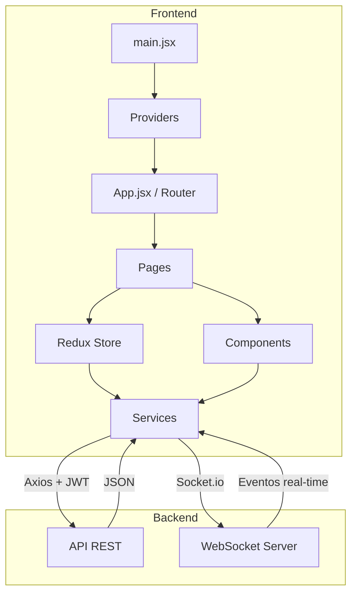

# 🦷 AsistDental — Contexto del Proyecto Frontend

> **Sistema de gestión integral para clínicas dentales.**
> Este documento describe la arquitectura, módulos, rutas, servicios, librerías y convenciones del frontend.

---

## 1. Información General

| Campo              | Valor                                                    |
| :----------------- | :------------------------------------------------------- |
| **Nombre**         | asistdental-f                                            |
| **Versión**        | 1.0.0                                                    |
| **Tipo**           | SPA (Single Page Application)                            |
| **Framework**      | React 18                                                 |
| **Bundler**        | Vite 5                                                   |
| **UI Framework**   | Material UI (MUI) 5                                      |
| **Estado Global**  | Redux Toolkit + React Context                            |
| **Lenguaje**       | JavaScript / JSX (con soporte de TypeScript configurado) |
| **Deploy**         | Vercel (SPA rewrite a `index.html`)                      |
| **Puerto dev**     | `3000`                                                   |
| **API Backend**    | Variable `VITE_API_URL` (default `http://127.0.0.1:3000`) |

---

## 2. Arquitectura General

```
src/
├── App.jsx                  # Definición de rutas principales
├── main.jsx                 # Punto de entrada — providers globales
├── assets/                  # Imágenes, logos, animaciones Lottie (.json)
├── components/              # Componentes reutilizables y layout
│   ├── Layout/              #   Layout principal (sidebar + header + contenido)
│   ├── common/              #   Componentes genéricos (Button, DataTable, Pagination, SearchInput)
│   ├── modals/              #   Modales organizados por dominio (citas, clínica, pagos, pacientes)
│   ├── routes/              #   ProtectedRoute (guard de autenticación y permisos)
│   ├── Header.jsx           #   Barra superior
│   ├── ReciboPDF.jsx        #   Generación de recibos PDF
│   └── recibosPDFcuotas.jsx #   Recibos PDF para cuotas
├── context/                 # React Context API
│   ├── authContext.jsx      #   Autenticación (JWT)
│   └── clinicaContext.jsx   #   Datos de la clínica activa
├── Hooks/                   # Custom hooks
│   ├── useCitas.js          #   Lógica de citas
│   ├── usePacientesTratamientos.js
│   ├── useSession.js        #   Sesión del usuario
│   └── useTimeBlocks.js     #   Bloques de tiempo para agenda
├── pages/                   # Páginas/vistas principales
│   ├── 404/                 #   Página no encontrada
│   ├── Agenda/              #   Calendario y gestión de citas
│   ├── Clinica/             #   Configuración de la clínica
│   ├── Inventario/          #   Gestión de productos y lotes
│   ├── Login/               #   Inicio de sesión
│   ├── Odontogramas/        #   Diagrama dental interactivo
│   ├── Pacientes/           #   CRUD y detalle de pacientes
│   ├── Pagos/               #   Gestión de pagos y cuotas
│   ├── Panel/               #   Dashboard principal
│   ├── Periodontograma/     #   Diagrama periodontal (SEPA, tablas, resumen sextantes)
│   ├── Reportes/            #   Reportes clínicos
│   ├── BetaPage.jsx         #   Página beta/experimental
│   ├── ClinicasView.jsx     #   Listado de clínicas
│   └── RegistroClinica.jsx  #   Registro de nueva clínica
├── services/                # Capa de comunicación con la API REST
│   ├── api.js               #   Instancia Axios centralizada (interceptors)
│   ├── requestService.js    #   Wrapper genérico GET/POST/PUT/PATCH/DELETE
│   ├── authService.js       #   Callback de logout forzado (401)
│   ├── sockets/socket.js    #   Conexión Socket.io (WebSocket)
│   └── *Services.js         #   Servicios por dominio (24 archivos)
├── store/                   # Redux Toolkit
│   ├── index.js             #   Configuración del store (12 slices)
│   └── <dominio>/           #   Carpeta por slice con Slice + Thunks
├── theme/                   # Sistema de diseño MUI
│   ├── theme.js             #   createAppTheme() — colores dinámicos por clínica
│   └── AppThemeProvider.jsx #   Provider que inyecta el tema
└── utils/                   # Utilidades generales
    └── generarReciboPDF.js  #   Función para crear PDFs de recibos
```

---

## 3. Providers Globales (main.jsx)

El árbol de providers se monta en el siguiente orden:

```
React.StrictMode
 └─ BrowserRouter           (react-router-dom)
     └─ Provider             (Redux store)
         └─ AuthProvider     (contexto JWT)
             └─ ClinicaProvider (datos de la clínica)
                 └─ AppThemeProvider (tema MUI dinámico)
                     └─ App
```

### AuthContext (`authContext.jsx`)
- Almacena `user`, `token`, `loadingAuth`.
- Decodifica JWT con `jwt-decode`; valida expiración.
- Persiste token en `localStorage`.
- Registra callback de logout forzado ante HTTP 401.

### ClinicaContext (`clinicaContext.jsx`)
- Obtiene datos de la clínica activa (`id_clinica` del JWT).
- Provee `clinica` y `loading` a todo el árbol.
- Es consumido por `AppThemeProvider` para aplicar colores dinámicos.

---

## 4. Sistema de Rutas

Todas las rutas protegidas usan `<ProtectedRoute>` que verifica:
1. **Autenticación**: si no hay `user`, redirige a `/login`.
2. **Permisos**: si se pasa `permiso` y no está en `user.permisos[]`, redirige a `/404`.

| Ruta                               | Componente              | Permiso              | Descripción                      |
| :--------------------------------- | :---------------------- | :------------------- | :------------------------------- |
| `/login`                           | `Login`                 | —                    | Inicio de sesión                 |
| `/beta`                            | `BetaPage`              | —                    | Página experimental              |
| `/` (index)                        | `Panel` / redirect      | auth                 | Dashboard (o registro clínica si Owner) |
| `/pacientes`                       | `Pacientes`             | `permisos_pacientes` | Listado de pacientes             |
| `/pacientes/:id`                   | `PatientDetails`        | `permisos_pacientes` | Detalle de paciente              |
| `/pacientes/:id/odontograma`       | `OdontogramaVista`      | `permisos_odontograma` | Odontograma del paciente       |
| `/pacientes/:id/periodontograma`   | `PeriodontogramaVista`  | `permisos_odontograma` | Periodontograma del paciente   |
| `/clinica`                         | `Clinica`               | `permisos_clinica`   | Configuración de clínica         |
| `/inventario`                      | `Inventario`            | `permisos_inventario`| Gestión de inventario            |
| `/reportes`                        | `Reportes`              | `VER_REPORTES`       | Reportes                         |
| `/pagos`                           | `Pagos`                 | `permisos_pacientes` | Gestión de pagos                 |
| `/agenda`                          | `Agenda`                | `permisos_pacientes` | Calendario de citas              |
| `/historialCitas`                  | `CitasView`             | `permisos_pacientes` | Historial de citas               |
| `/registro-clinica`                | `RegistroClinica`       | auth                 | Registro de nueva clínica        |
| `/clinicas`                        | `ClinicasView`          | auth                 | Vista de clínicas                |
| `*`                                | `NotFound (404)`        | —                    | Página no encontrada             |

---

## 5. Estado Global — Redux Toolkit

12 slices configurados en `store/index.js`, cada uno en su propia carpeta `store/<dominio>/`:

| Slice                    | Descripción                                          |
| :----------------------- | :--------------------------------------------------- |
| `pacientes`              | CRUD de pacientes                                    |
| `antecedentes`           | Antecedentes médicos de pacientes                    |
| `catalogoProcedimientos` | Catálogo de procedimientos dentales                  |
| `citas`                  | Gestión de citas (crear, reagendar, estados)         |
| `clinica`                | Datos de la clínica                                  |
| `configuracionClinica`   | Configuración avanzada de la clínica                 |
| `consultas`              | Consultas médicas                                    |
| `cuotas`                 | Cuotas / planes de pago                              |
| `dentistas`              | Gestión de dentistas / personal                      |
| `diagnosticos`           | Diagnósticos dentales                                |
| `odontograma`            | Odontograma (diagrama dental con versiones)          |
| `periodontograma`        | Periodontograma (salud periodontal)                  |

Cada carpeta de slice contiene típicamente:
- `<dominio>Slice.js` — `createSlice` con reducers y extraReducers.
- Thunks asíncronos (generalmente en el mismo archivo o separados).

---

## 6. Servicios (Capa API)

### Configuración central

| Archivo             | Descripción                                                                 |
| :------------------ | :-------------------------------------------------------------------------- |
| `api.js`            | Instancia Axios con `baseURL` de `VITE_API_URL`; interceptors de req (JWT Bearer) y res (401 → logout) |
| `requestService.js` | Wrapper que expone `get`, `post`, `put`, `patch`, `delete` y extrae `res.data` automáticamente |
| `authService.js`    | Módulo de callback para logout forzado (desacopla contexto de interceptor)  |

### Servicios por dominio

| Servicio                              | Endpoints principales (base)                                   |
| :------------------------------------ | :------------------------------------------------------------- |
| `pacienteServices.js`                 | `/pacientes` — CRUD + listado por clínica                      |
| `citasServices.js`                    | `/citas` — crear, por día/semana/mes, confirmar/completar/cancelar/reagendar |
| `clinicaServices.js`                  | `/clinicas` — CRUD + login + registro                          |
| `userServices.js`                     | `/usuarios` — CRUD + activar/desactivar                        |
| `dentistasServices.js`                | `/dentistas` — gestión de dentistas                            |
| `rolesServices.js`                    | `/roles` — roles de usuario                                    |
| `inventarioServices.js`              | `/productos` + `/lotes` — productos, lotes (CRUD)              |
| `pagosService.js`                     | `/pagos` + `/planes-pago` — pagos por paciente/clínica         |
| `cuotasServices.js`                   | `/cuotas` — gestión de cuotas                                  |
| `odontogramaServices.js`              | `/odontogramas` — CRUD + diagnósticos + procedimientos + versiones |
| `periodontogramaServices.js`          | `/periodontogramas` — diagrama periodontal                     |
| `consultasServices.js`                | `/consultas` — consultas médicas                               |
| `antecedentesServices.js`             | `/antecedentes` — antecedentes médicos                         |
| `diagnosticosServices.js`             | `/diagnosticos` — diagnósticos                                 |
| `examenesOralesServices.js`           | `/examenes-orales` — exámenes orales                           |
| `tratamientosServices.js`             | `/tratamientos` — tratamientos dentales                        |
| `catalogoProcedimientosServices.js`   | `/catalogo-procedimientos` — catálogo de procedimientos        |
| `configuracionClinicaServices.js`     | `/configuracion-clinica` — config. avanzada                    |
| `productosServices.js`                | `/productos` — servicios adicionales de productos              |
| `lotesServices.js`                    | `/lotes` — servicios adicionales de lotes                      |
| `movimientosServices.js`              | `/movimientos` — movimientos de inventario                     |

### WebSocket (Tiempo real)

| Archivo            | Descripción                                             |
| :----------------- | :------------------------------------------------------ |
| `sockets/socket.js`| Conexión Socket.io a `http://127.0.0.1:3000` via WebSocket |

---

## 7. Componentes Reutilizables

### Layout (`components/Layout/`)
- `Layout.jsx` — Estructura base con sidebar responsive y área de contenido.
- `Logo.jsx` — Logo de la clínica.

### Comunes (`components/common/`)

| Componente            | Propósito                                     |
| :-------------------- | :-------------------------------------------- |
| `Button.jsx`          | Botón reutilizable                            |
| `DataTable.jsx`       | Tabla de datos genérica con soporte de acciones |
| `Pagination.jsx`      | Paginación reutilizable                       |
| `SearchInput.jsx`     | Input de búsqueda                             |
| `NavegationButtons.jsx` | Botones de navegación                       |
| `ImageLogin.jsx`      | Imagen decorativa del login                   |

### Modales (`components/modals/`)

Las modales están organizados por dominio:

| Subdirectorio      | Contenido                                           |
| :----------------- | :-------------------------------------------------- |
| `Dates/`           | 5 modales para gestión de citas (crear, editar, confirmar...) |
| `clinica/`         | 7 modales para configuración de clínica (usuarios, roles, dentistas...) |
| `pagos/`           | 3 modales para pagos y cuotas                       |
| `stepsNewPatient/` | 5 pasos de wizard para registro de nuevo paciente   |
| `commonModals/`    | 2 modales genéricos (confirmación, etc.)            |
| `PatientModal.jsx` | Modal principal de paciente                         |

### PDF
- `ReciboPDF.jsx` — Componente para generar recibos PDF.
- `recibosPDFcuotas.jsx` — Recibos PDF específicos para cuotas.

### Módulos Clínicos Complejos
El módulo de **Periodontograma** (`pages/Periodontograma/`) es un ejemplo de arquitectura modular interna debido a su alta complejidad clínica (estilo SEPA). Cuenta con:
- `PeriodontogramaVista.jsx` / `Periodontograma.jsx` — Contenedores principales y manejo de estado.
- `PeriodontogramaGrid.jsx` — Cuadrícula interactiva de entrada de medidas clínicas.
- `PeriodontogramaArchTable.jsx` — Representación tabular de medidas dentales por arcada.
- `ToothDiagramSEPA.jsx` — Visualización gráfica SVG del diagrama periodontal tipo SEPA.
- `ResumenSextantes.jsx` — Indicadores globales y cálculos de sangrado/placa agrupados por sextantes.
- `PeriodontogramaToothModal.jsx` — Modal enfocado en la edición profunda por pieza dental.
- `periodontogramaConstants.js` — Lógica, mapeos y colores centralizados.

---

## 8. Custom Hooks

| Hook                          | Propósito                                              |
| :---------------------------- | :----------------------------------------------------- |
| `useCitas.js`                 | Lógica de carga, filtro y gestión de citas             |
| `usePacientesTratamientos.js` | Relación pacientes ↔ tratamientos activos              |
| `useSession.js`               | Información de sesión del usuario autenticado           |
| `useTimeBlocks.js`            | Generación de bloques de tiempo para la agenda/calendario |

---

## 9. Sistema de Tema (MUI)

### `theme.js` — `createAppTheme(coloresClinica)`
- Recibe `{ primary, secondary }` desde los datos de la clínica.
- **Colores por defecto**: primary `#00676E`, secondary `#F97316`.
- **Tipografía**: `Inter`, `Roboto`, sistema sans-serif.
- Personaliza sombras, bordes redondeados (8–12px), y scrollbars.
- Aplica overrides globales a `MuiButton`, `MuiTextField`, `MuiCard`, `MuiPaper`, `MuiCssBaseline`.

### `AppThemeProvider.jsx`
- Lee `clinica` desde `ClinicaContext`.
- Re-calcula el tema con `useMemo` cuando cambian los colores de la clínica.
- Aplica `<ThemeProvider>` + `<CssBaseline>`.

---

## 10. Librerías y Dependencias

### Dependencias de producción

| Librería                     | Versión   | Uso                                         |
| :--------------------------- | :-------- | :------------------------------------------- |
| `react` / `react-dom`       | ^18.2.0   | Framework UI principal                       |
| `react-router-dom`          | ^6.20.1   | Enrutamiento SPA                             |
| `@reduxjs/toolkit`          | ^2.11.2   | Estado global (slices, thunks)               |
| `react-redux`               | ^9.2.0    | Bindings React ↔ Redux                       |
| `@mui/material`             | ^5.14.20  | Componentes UI (Material Design)             |
| `@mui/icons-material`       | ^5.14.19  | Iconos Material Design                       |
| `@mui/x-date-pickers`       | ^6.18.1   | Date/time pickers                            |
| `@emotion/react` / `styled` | ^11.11.x  | CSS-in-JS para MUI                           |
| `axios`                      | ^1.13.2   | Cliente HTTP para API REST                   |
| `socket.io-client`          | ^4.8.1    | WebSocket (eventos en tiempo real)           |
| `jwt-decode`                | ^4.0.0    | Decodificación de tokens JWT                 |
| `framer-motion`             | ^12.30.0  | Animaciones y transiciones                   |
| `lottie-react`              | ^2.4.1    | Animaciones Lottie (JSON)                    |
| `lucide-react`              | ^0.562.0  | Iconos adicionales (Lucide)                  |
| `dayjs`                     | ^1.11.19  | Manipulación de fechas (pickers MUI)         |
| `date-fns`                  | ^2.30.0   | Manipulación de fechas (formateo)            |
| `jspdf`                     | ^4.0.0    | Generación de PDFs en el cliente             |
| `jspdf-autotable`           | ^5.0.7    | Tablas automáticas en PDFs                   |
| `serve`                     | ^14.2.5   | Servidor estático (preview/producción local) |

### Dependencias de desarrollo

| Librería                    | Versión | Uso                          |
| :-------------------------- | :------ | :--------------------------- |
| `vite`                      | ^5.0.8  | Bundler y dev server         |
| `@vitejs/plugin-react`      | ^4.2.1  | Soporte JSX/React en Vite    |
| `typescript`                | ^5.3.3  | TypeScript (disponible, no primario) |
| `@types/react`              | ^18.2.43| Tipos TS para React          |
| `@types/react-dom`          | ^18.2.17| Tipos TS para ReactDOM       |

---

## 11. Patrones y Convenciones

### Autenticación
- JWT almacenado en `localStorage`.
- Interceptor Axios agrega `Authorization: Bearer <token>` a cada request.
- Respuestas 401 disparan logout automático vía callback desacoplado.

### Comunicación con API
- **`api.js`**: instancia Axios centralizada con interceptores.
- **`requestService.js`**: wrapper que extrae `res.data` automáticamente.
- Los servicios de dominio usan indistintamente `requestService` o `api` directamente.

### Roles y Permisos
- El JWT decodificado contiene `nombre_rol` y `permisos[]`.
- `ProtectedRoute` verifica permisos como: `permisos_pacientes`, `permisos_clinica`, `permisos_inventario`, `permisos_odontograma`, `VER_REPORTES`.
- Rol `Owner` recibe redirect especial a `/registro-clinica`.

### Estructura de páginas
- Cada página tiene su carpeta dentro de `pages/` con subcomponentes internos.
- Las páginas más complejas (Agenda, Clínica, Pacientes) contienen subdirectorios propios.

### Theming dinámico
- Cada clínica puede tener `color_principal` y `color_secundario` propios.
- El tema MUI se re-genera dinámicamente al cambiar de clínica.

### Assets
- Animaciones Lottie: `Diente.json`, `Muela.json`, `Tooth.json`, `Happy Star.json`, `Sad Star.json`.
- Logos: `LOGO.jpg`, `LOGO.png`, `image.png`.

---

## 12. Scripts disponibles

```bash
npm run dev      # Servidor de desarrollo en puerto 3000
npm run build    # Build de producción (Vite)
npm run preview  # Preview del build de producción
```

---

## 13. Variables de Entorno

| Variable        | Descripción                       | Default                  |
| :-------------- | :-------------------------------- | :----------------------- |
| `VITE_API_URL`  | URL base de la API REST backend   | `http://127.0.0.1:3000`  |

---

## 14. Diagrama de Flujo de Datos



---

> **Nota**: Este proyecto es exclusivamente el **frontend**. El backend es una API REST independiente que se conecta vía HTTP (Axios) y WebSocket (Socket.io). Las rutas de la API empiezan con los prefijos documentados en la sección de servicios.
