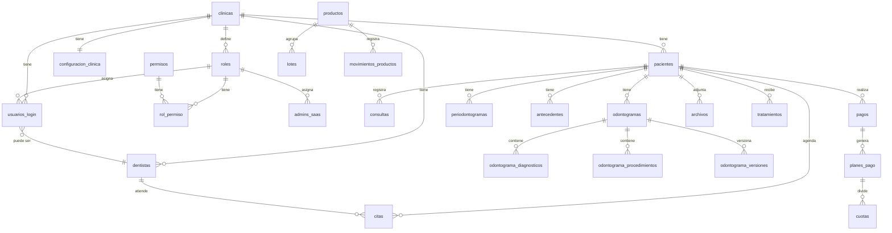

# 🦷 AsistDental — Backend (asistDental-B)

> **Contexto completo del proyecto para que cualquier IA o desarrollador entienda la arquitectura, base de datos, servicios, rutas, controladores y modelos.**

---

## 1. Descripción General

**AsistDental** es una plataforma **SaaS multi-clínica** para la gestión de clínicas dentales.  
Este repositorio (`asistDental-B`) contiene únicamente el **backend / API REST**, construido con **Node.js + Express**.

| Aspecto            | Detalle                                          |
| ------------------ | ------------------------------------------------ |
| Runtime            | Node.js 20 (Alpine en Docker)                    |
| Framework          | Express 4.18                                     |
| Base de datos      | **MySQL** (Railway) vía `mysql2/promise`          |
| Almacenamiento     | **Supabase** (bucket), **Cloudinary** (imágenes)  |
| Autenticación      | **JWT** (`jsonwebtoken`) + **bcryptjs**           |
| Generación de PDFs | `pdfkit`                                         |
| Upload de archivos | `multer` (disco local y Cloudinary)              |
| Puerto por defecto | `3001`                                           |
| CORS permitidos    | `https://asist-dental.com`, `http://localhost:3000` |

---

## 2. Arquitectura del Proyecto

```
asistDental-B/
├── Dockerfile                  # Imagen Docker (node:20-alpine)
├── .env                        # Variables de entorno
├── package.json
├── uploads/                    # Archivos subidos (logos, documentos)
└── src/
    ├── index.js                # Entry point — Crea app Express, monta middlewares y rutas
    ├── config/
    │   └── db.js               # Pool de conexión MySQL (mysql2/promise)
    │
    ├── middlewares/
    │   ├── authMiddleware.js    # Verifica JWT en header Authorization
    │   ├── checkPermiso.js     # Verifica que el usuario tenga un permiso específico
    │   ├── errorHandler.js     # Manejo global de errores
    │   ├── upload.js           # Multer — archivos generales (max 10 MB)
    │   └── uploadLogo.js       # Multer — logos de clínica (max 5 MB, carpeta uploads/logos)
    │
    ├── models/                 # Modelos globales (autenticación y roles)
    │   ├── adminSaasModel.js
    │   ├── usuarioModel.js
    │   ├── rolModel.js
    │   ├── permisoModel.js
    │   └── rolPermisoModel.js
    │
    ├── controllers/            # Controladores globales
    │   ├── authController.js   # Registro de clínica + Login (clínica y SaaS)
    │   ├── rolesController.js
    │   └── usuariosController.js
    │
    ├── routes/                 # Rutas globales
    │   ├── adminSaasRoutes.js  # POST /saas/admins
    │   ├── rolesRoutes.js      # GET /roles/:id_clinica
    │   └── usuariosRoutes.js   # CRUD /usuarios
    │
    └── modules/                # ⭐ Módulos por dominio (MVC modular)
        ├── agenda/
        ├── antecedentes/
        ├── archivos/
        ├── catalogoProcedimientos/
        ├── citas/
        ├── clinica/
        ├── consultas/
        ├── cuotas/
        ├── dentistas/
        ├── diagnosticos/
        ├── examenesOrales/
        ├── inventario/
        ├── odontogramas/
        ├── pacientes/
        ├── pagos/
        ├── periodontogramas/
        └── tratamientos/
```

### Patrón Arquitectónico

Se utiliza una **arquitectura MVC modular por dominio**:

```
modules/<dominio>/
  ├── <dominio>Model.js         # Consultas SQL directas (sin ORM)
  ├── <dominio>Controller.js    # Lógica de request/response
  ├── <dominio>Routes.js        # Definición de rutas Express
  └── <dominio>Service.js       # (Opcional) Lógica de negocio compleja
```

> **No se usa ORM.** Todos los modelos ejecutan queries SQL crudos con `db.execute(...)` usando `mysql2/promise`.

---

## 3. Base de Datos (MySQL)

### 3.1 Tablas Identificadas (desde los modelos y queries)

| Tabla                      | Módulo / Modelo                   | Descripción                                 |
| -------------------------- | --------------------------------- | ------------------------------------------- |
| `clinicas`                 | `clinica/clinicaModel`            | Clínicas registradas en el SaaS             |
| `configuracion_clinica`    | `clinica/configuracionClinicaModel` | Configuración de horarios, agenda, etc.   |
| `pacientes`                | `pacientes/pacienteModel`         | Pacientes de una clínica                    |
| `usuarios_login`           | `models/usuarioModel`             | Usuarios de login por clínica               |
| `admins_saas`              | `models/adminSaasModel`           | Administradores globales del SaaS           |
| `roles`                    | `models/rolModel`                 | Roles (SuperAdmin, etc.) por clínica        |
| `permisos`                 | `models/permisoModel`             | Permisos del sistema (tabla catálogo)       |
| `rol_permiso`              | `models/rolPermisoModel`          | Relación N:M entre roles y permisos         |
| `dentistas`                | `dentistas/dentistaModel`         | Dentistas vinculados a una clínica          |
| `citas`                    | `citas/citasModel`                | Citas odontológicas                         |
| `agenda`                   | `agenda/agendaModel`              | Bloques / horarios de agenda                |
| `consultas`                | `consultas/consultaModel`         | Historial de consultas                      |
| `tratamientos`             | `tratamientos/tratamientoModel`   | Tratamientos dentales                       |
| `catalogo_procedimientos`  | `catalogoProcedimientos/...Model` | Catálogo de procedimientos                  |
| `diagnosticos`             | `diagnosticos/diagnosticosModel`  | Diagnósticos clínicos                       |
| `odontogramas`             | `odontogramas/models/odontogramaModel` | Odontogramas del paciente              |
| `odontograma_diagnosticos` | `odontogramas/models/oDiagnosticosModel` | Diagnósticos en odontograma          |
| `odontograma_procedimientos` | `odontogramas/models/oProcedimientosModel` | Procedimientos en odontograma     |
| `odontograma_versiones`    | `odontogramas/models/oVersionesModel` | Versionamiento de odontogramas         |
| `material_usado`           | `odontogramas/models/materialUsadoModel` | Materiales usados en procedimientos |
| `periodontogramas`         | `periodontogramas/periodontogramasModel` | Periodontogramas                    |
| `antecedentes`             | `antecedentes/antecedentesModel`  | Antecedentes médicos del paciente           |
| `examen_inicial_extraoral` | `examenesOrales/examenInicialExtraoralModel` | Examen extraoral                 |
| `examen_inicial_intraoral` | `examenesOrales/examenInicialIntraoralModel` | Examen intraoral                 |
| `pagos`                    | `pagos/pagosModel`                | Registro de pagos                           |
| `planes_pago`              | `pagos/planesPago/planesPagoModel` | Planes de pago (financiamiento)            |
| `cuotas`                   | `cuotas/cuotasModel`              | Cuotas de planes de pago                    |
| `archivos`                 | `archivos/archivosModel`          | Archivos/documentos subidos                 |
| `productos`                | `inventario/productos/productosModel` | Productos de inventario                 |
| `lotes`                    | `inventario/lotes/lotesModel`     | Lotes de inventario                         |
| `movimientos_productos`    | `inventario/movimientos_productos/mpModel` | Movimientos de inventario        |

### 3.2 Relaciones Principales



---

## 4. Autenticación y Autorización

### 4.1 Flujo de Autenticación

1. **Registro de Clínica** (`POST /clinicas/registro`):
   - Crea clínica → rol SuperAdmin → permisos → dentista (opcional) → usuario → JWT (8h)
   - Todo en una **transacción** MySQL

2. **Login** (`POST /clinicas/login`):
   - Busca primero en `usuarios_login` (usuario de clínica)
   - Si no existe, busca en `admins_saas` (admin SaaS)
   - Valida password con `bcrypt.compare`
   - Retorna JWT con payload:
     ```json
     {
       "tipo_usuario": "clinica" | "saas",
       "id_usuario": 1,
       "id_clinica": 1,
       "id_dentista": 1,
       "id_rol": 1,
       "nombre_rol": "SuperAdmin",
       "permisos": ["permisos_pacientes", "permisos_clinica", ...]
     }
     ```

### 4.2 Middlewares de Seguridad

| Middleware          | Archivo                | Función                                                  |
| ------------------- | ---------------------- | -------------------------------------------------------- |
| `authMiddleware`    | `authMiddleware.js`    | Verifica JWT en `Authorization: Bearer <token>`, inyecta `req.user` |
| `checkPermiso(nombre)` | `checkPermiso.js`  | Verifica que `req.user.permisos` incluya el permiso dado |
| `helmet`            | (built-in)             | Headers de seguridad HTTP                                |
| `cors`              | (built-in)             | Limita orígenes permitidos                               |

### 4.3 Permisos del Sistema

Los permisos se almacenan en la tabla `permisos` y se verifican con `checkPermiso()`:

- `permisos_pacientes` — Gestión de pacientes
- `permisos_clinica` — Configuración de clínica y pagos
- `permisos_odontograma` — Odontogramas
- `permisos_agenda` — Agenda y citas
- `gestionar_saas` — Exclusivo para admins SaaS (excluido de SuperAdmin de clínica)

---

## 5. Módulos y Endpoints

### 5.1 Rutas Globales

| Prefijo       | Archivo de Rutas       | Métodos        | Descripción                   |
| ------------- | ---------------------- | -------------- | ----------------------------- |
| `/clinicas`   | `clinicaRoutes.js`     | POST, PUT, GET | Registro, login, editar clínica |
| `/roles`      | `rolesRoutes.js`       | GET            | Listar roles por clínica       |
| `/usuarios`   | `usuariosRoutes.js`    | CRUD           | Gestión de usuarios de clínica |

### 5.2 Módulos de Dominio

| Prefijo                      | Módulo                    | Endpoints                                              | Auth | Permiso              |
| ---------------------------- | ------------------------- | ------------------------------------------------------- | ---- | -------------------- |
| `/pacientes`                 | `pacientes`               | POST, GET /:id, GET /clinica/:id, PUT, DELETE           | ✅   | `permisos_pacientes` |
| `/api`                       | `pacientes` (completo)    | Ruta para paciente completo con todo su historial       | ✅   | —                    |
| `/examenes`                  | `examenesOrales`          | Examen extraoral e intraoral                            | ✅   | —                    |
| `/antecedentes`              | `antecedentes`            | CRUD antecedentes médicos                               | ✅   | —                    |
| `/dentistas`                 | `dentistas`               | CRUD dentistas                                          | ✅   | —                    |
| `/agenda`                    | `agenda`                  | Gestión de bloques de agenda                            | ✅   | `permisos_agenda`    |
| `/citas`                     | `citas`                   | Gestión de citas                                        | ✅   | `permisos_agenda`    |
| `/consultas`                 | `consultas`               | Registro de consultas                                   | ✅   | —                    |
| `/tratamientos`              | `tratamientos`            | CRUD tratamientos                                       | ✅   | —                    |
| `/catalogo-procedimientos`   | `catalogoProcedimientos`  | Catálogo de procedimientos dentales                     | ✅   | —                    |
| `/odontogramas`              | `odontogramas`            | CRUD + diagnósticos + procedimientos + versiones        | ✅   | `permisos_odontograma` |
| `/diagnosticos`              | `diagnosticos`            | Gestión de diagnósticos                                 | ✅   | —                    |
| `/periodontogramas`          | `periodontogramas`        | Periodontogramas                                        | ✅   | —                    |
| `/pagos`                     | `pagos`                   | CRUD pagos + resumen por clínica                        | ✅   | `permisos_clinica`   |
| `/planes-pago`               | `pagos/planesPago`        | Planes de financiamiento                                | ✅   | —                    |
| `/cuotas`                    | `cuotas`                  | Gestión de cuotas de planes de pago                     | ✅   | —                    |
| `/productos`                 | `inventario/productos`    | CRUD productos de inventario                            | ✅   | —                    |
| `/lotes`                     | `inventario/lotes`        | CRUD lotes                                              | ✅   | —                    |
| `/movimientos-productos`     | `inventario/movimientos`  | Registro de movimientos de inventario                   | ✅   | —                    |
| `/configuracionClinica`      | `clinica/configuracion`   | Configuración de horarios y agenda                      | ✅   | —                    |
| `/api/archivos`              | `archivos`                | Upload/descarga de archivos (usa Multer)                | ✅   | —                    |
| `/uploads`                   | (estático)                | Servir archivos estáticos subidos                       | —    | —                    |

---

## 6. Servicios (Capa de Lógica de Negocio)

Algunos módulos tienen una capa `Service` separada para lógica compleja:

| Servicio                            | Ubicación                                | Responsabilidad                                         |
| ----------------------------------- | ---------------------------------------- | ------------------------------------------------------- |
| `agendaService.js`                  | `modules/agenda/`                        | Lógica de bloques de agenda                             |
| `citasService.js`                   | `modules/citas/`                         | Validaciones y lógica de citas                          |
| `cuotasService.js`                  | `modules/cuotas/`                        | Cálculo y generación de cuotas                          |
| `pagosService.js`                   | `modules/pagos/`                         | Lógica de procesamiento de pagos                        |
| `dentistasConUsuarioService.js`     | `modules/dentistas/`                     | Crear dentista y su usuario simultáneamente             |
| `odontogramaService.js`             | `modules/odontogramas/services/`         | Lógica compleja de odontogramas                         |
| `oProcedimientosServices.js`        | `modules/odontogramas/services/`         | Procedimientos en odontograma                           |
| `oVersionServices.js`              | `modules/odontogramas/services/`         | Versionamiento de odontogramas                          |
| `periodontogramaService.js`         | `modules/periodontogramas/`              | Lógica de periodontogramas                              |

---

## 7. Modelos por Módulo

Cada modelo es un **objeto literal** con métodos `async` que ejecutan **queries SQL directos**:

```javascript
// Patrón típico de un modelo
const db = require('../../config/db');

const Ejemplo = {
  async create(data) {
    const [result] = await db.execute(`INSERT INTO tabla (...) VALUES (?, ?)`, [data.campo1, data.campo2]);
    return result.insertId;
  },
  async findById(id) {
    const [rows] = await db.execute(`SELECT * FROM tabla WHERE id = ?`, [id]);
    return rows[0];
  }
};

module.exports = Ejemplo;
```

### Modelos Globales (`src/models/`)

| Modelo              | Tabla              | Métodos                                                      |
| ------------------- | ------------------ | ------------------------------------------------------------ |
| `usuarioModel`      | `usuarios_login`   | `create`, `findByUsuarioWithRol`, `findByClinica`, `update`, `activarUsuarios` |
| `adminSaasModel`    | `admins_saas`      | `create`, `findByUsuarioWithRol`                             |
| `rolModel`          | `roles`            | `getAllForClinica`, `create`                                  |
| `permisoModel`      | `permisos`         | `getAllForClinica`, `getPermisosByRol`                        |
| `rolPermisoModel`   | `rol_permiso`      | `assign`                                                     |

### Modelos por Módulo (`src/modules/`)

| Módulo                  | Modelo(s)                                                                          |
| ----------------------- | ---------------------------------------------------------------------------------- |
| `clinica`               | `clinicaModel` (create, update), `configuracionClinicaModel`, `defaultConfiguracionClinica` |
| `pacientes`             | `pacienteModel`                                                                    |
| `dentistas`             | `dentistaModel`                                                                    |
| `citas`                 | `citasModel`                                                                       |
| `agenda`                | `agendaModel`                                                                      |
| `consultas`             | `consultaModel`                                                                    |
| `tratamientos`          | `tratamientoModel`                                                                 |
| `catalogoProcedimientos`| `catalogoProcedimientosModel`                                                      |
| `diagnosticos`          | `diagnosticosModel`                                                                |
| `examenesOrales`        | `examenInicialExtraoralModel`, `examenInicialIntraoralModel`                       |
| `antecedentes`          | `antecedentesModel`                                                                |
| `odontogramas`          | `odontogramaModel`, `oDiagnosticosModel`, `oProcedimientosModel`, `oVersionesModel`, `materialUsadoModel` |
| `periodontogramas`      | `periodontogramasModel`                                                            |
| `pagos`                 | `pagosModel`, `planesPagoModel`                                                    |
| `cuotas`                | `cuotasModel`                                                                      |
| `archivos`              | `archivosModel`                                                                    |
| `inventario`            | `productosModel`, `lotesModel`, `mpModel`                                          |

---

## 8. Configuración y Variables de Entorno

```env
PORT=3001                    # Puerto del servidor
DB_HOST=...                  # Host MySQL (Railway)
DB_USER=root                 # Usuario MySQL
DB_PASSWORD=...              # Contraseña MySQL
DB_PORT=11067                # Puerto MySQL
DB_NAME=railway              # Nombre de la base de datos
SUPABASE_URL=...             # URL de Supabase
SUPABASE_SERVICE_ROLE_KEY=...# Service role key de Supabase
JWT_SECRET=...               # Secreto para firmar JWT
```

---

## 9. Stack Tecnológico Detallado

| Dependencia                    | Versión  | Uso                                               |
| ------------------------------ | -------- | -------------------------------------------------- |
| `express`                      | ^4.18.2  | Framework HTTP                                     |
| `mysql2`                       | ^3.15.3  | Driver MySQL con soporte a Promises                |
| `@supabase/supabase-js`        | ^2.95.3  | Cliente Supabase (almacenamiento de archivos)      |
| `jsonwebtoken`                 | ^9.0.3   | Generación y verificación de JWT                   |
| `bcryptjs`                     | ^3.0.3   | Hash de contraseñas                                |
| `multer`                       | ^2.0.2   | Upload de archivos (middleware)                    |
| `multer-storage-cloudinary`    | ^4.0.0   | Storage de Multer para Cloudinary                  |
| `cloudinary`                   | ^1.41.3  | CDN / almacenamiento de imágenes                   |
| `pdfkit`                       | ^0.17.2  | Generación de documentos PDF                       |
| `helmet`                       | ^7.0.0   | Seguridad HTTP headers                             |
| `cors`                         | ^2.8.5   | Cross-Origin Resource Sharing                      |
| `morgan`                       | ^1.10.0  | Logger de requests HTTP                            |
| `dotenv`                       | ^16.3.1  | Carga de variables de entorno                      |

**Dev dependencies:** `eslint`, `nodemon`

---

## 10. Despliegue

- **Docker**: `Dockerfile` con imagen `node:20-alpine`, expone puerto `3001`
- **Base de datos**: MySQL desplegado en **Railway**
- **Frontend**: SPA en `https://asist-dental.com` (no incluido en este repo)
- **Comando de inicio**: `node src/index.js`
- **Comando de desarrollo**: `nodemon src/index.js`

---

## 11. Convenciones y Patrones Importantes

1. **Idioma**: Todo el código (variables, tablas, endpoints, mensajes) está en **español**
2. **Multi-tenancy**: Cada recurso está vinculado a un `id_clinica` para aislar datos entre clínicas
3. **Transacciones**: Operaciones críticas (registro de clínica) usan transacciones MySQL con `connection.beginTransaction()` / `commit()` / `rollback()`
4. **Sin ORM**: Todas las queries son SQL nativo con parámetros preparados (`?`)
5. **JWT en 8h**: Los tokens expiran en 8 horas
6. **Permisos inline**: Los permisos viajan dentro del JWT, no se consultan por request
7. **Archivos estáticos**: Se sirven desde `/uploads` con CORS configurado
8. **Modularidad**: Cada dominio de negocio tiene su carpeta auto-contenida dentro de `modules/`
